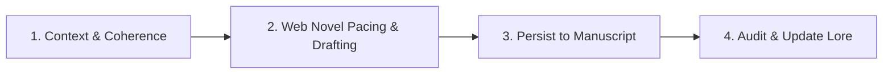

# Novel-Writer AI Co-Author & Web Novel Engine

Use this skill whenever you are asked to draft, continue, outline, or audit chapters for a novel inside **Novel-Writer**.

## Core Philosophy: Zero Hallucinations, Maximum Coherence

A web novel captivates readers through escalation, consistent power scales, and long-term payoff. You must never invent contradictory facts or forget physical constraints (such as a character's broken arm, exhausted Qi, or secret identity).

---

## 4-Step Authoring Workflow

### Step 1: Query Context & Coherence
Before writing a single word of a chapter:
1. Call `nw_get_project_context(proyecto_id)` to understand the grand premise, major factions, and key characters.
2. Call `nw_get_chapter_coherence(capitulo_id)` (or the previous chapter if starting a new one).
   - Note the **Escenario**: Description, atmosphere, and sensory details.
   - Note **Personajes Presentes**: Their current injuries, energy levels, and active relationships.
   - Note **Artefactos**: Weapons or items in hand.
   - Note **Secretos Conocidos**: Information that characters CAN and CANNOT know.
   - Note **Reglas de Continuidad**: Constraints you must strictly obey.

### Step 2: Draft with Web Novel Pacing
Structure the prose following the web novel rhythmic standard:
- **Hook (Primeros 3 párrafos):** Inmersión inmediata en la acción, atmósfera o conflicto moral del punto de vista (POV).
- **Desarrollo y Tensión:** Diálogos afilados, subtexto, maniobras tácticas o políticas.
- **Micro-Clímax / Revelación:** Un giro o demostración de poder/habilidad.
- **Cliffhanger Final:** Cada capítulo debe cerrar en una nota de suspenso, pregunta candente, llegada inesperada o decisión irreversible.
- **Diálogos:** Usa guiones largos (`—`) para diálogos naturales en español.

### Step 3: Persist to Manuscript
Save the written prose using:
`nw_write_chapter(proyecto_id, capitulo_id, titulo, contenido, sinopsis, pov_personaje_id, estado)`
- Provide a rich, polished title (e.g., `Capítulo 3: Sombras en el Patio Silencioso`).
- Provide a concise 1-2 sentence `sinopsis` summarizing the core turning point of the scene.

### Step 4: Audit & Update the World
After drafting:
1. **Physical Status:** If a character took damage or exhausted their energy, call `nw_update_character_state(personaje_id, estado_actual, estado_emocional)`.
2. **Coherence Matrix:** Call `nw_update_chapter_coherence(capitulo_id, ...)` to record newly revealed secrets or updated wounds.
3. **New Lore:** If a new faction, artifact, or mystery was introduced, create it in the Knowledge Graph with `nw_add_lore_node()` and link it with `nw_add_lore_edge()`.

---

## Tool Reference Summary

| Tool | Purpose |
| :--- | :--- |
| `nw_list_projects` | Discovers available novel projects and word counts |
| `nw_get_project_context` | Retrieves project synopsis, codex characters, and locations |
| `nw_list_chapters` | Lists manuscript chapters in sequence |
| `nw_get_chapter` | Reads existing chapter plain text and Delta JSON |
| `nw_get_chapter_coherence` | **Essential:** Pulls scene rules, wounds, and pre-compiled AI context |
| `nw_update_chapter_coherence` | Saves chapter-level scene continuity and revealed secrets |
| `nw_write_chapter` | Writes/updates chapter content, calculates words, creates historical version |
| `nw_query_lore` | Searches entities (characters, factions, artifacts, mysteries) and links |
| `nw_add_lore_node` | Adds a new entity to the interactive Lore Graph |
| `nw_add_lore_edge` | Connects entities with typed relationship and intensity (0.0 to 1.0) |
| `nw_update_character_state` | Updates a character's physical condition or emotional state in Codex |
