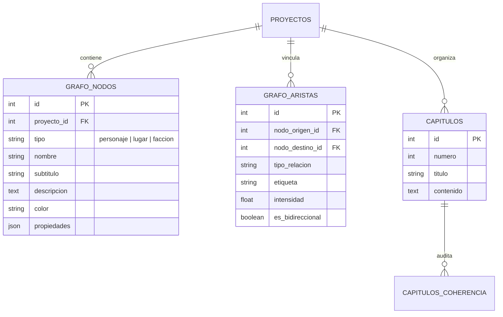

# Arquitectura Técnica :: Novel-Writer

Documento de arquitectura del motor de gestión literaria y servidor MCP.

---

## 1. Diagrama de Relación y Flujo de Lore



---

## 2. Integración MCP y Agentes

```mermaid
flowchart LR
    Agent["🤖 Antigravity / Claude Agent"] <-->|Protocolo MCP (JSON-RPC)| MCPServer["mcp_server/server.py"]
    MCPServer <-->|"PRAGMA integrity_check / SQL"| DB[("novel_writer.db (SQLite)")]
    DB -.->|Hook PostToolUse| Backup["backup_novel_db.py (Rotación 15)"]
    DB -.->|export-lore| Vault["lore_vault/ (Markdown + [[wikilinks]])"]
```
